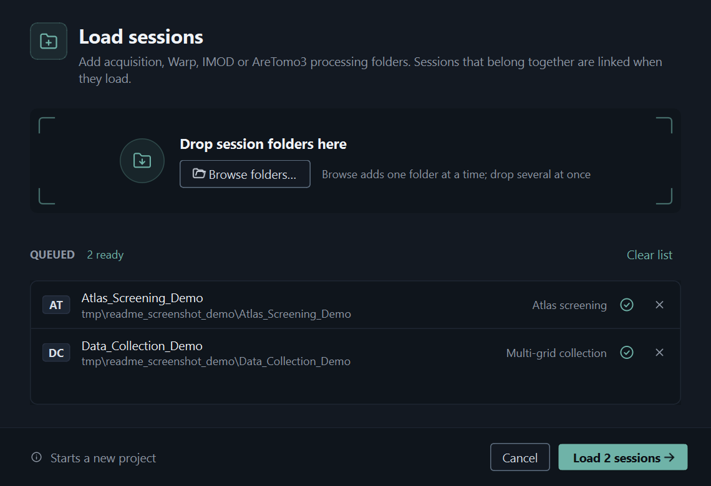
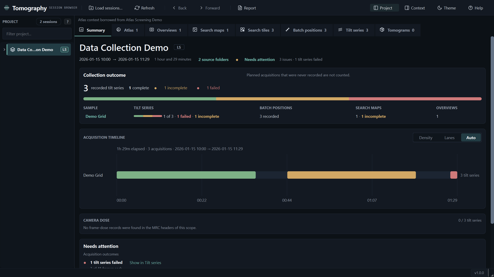
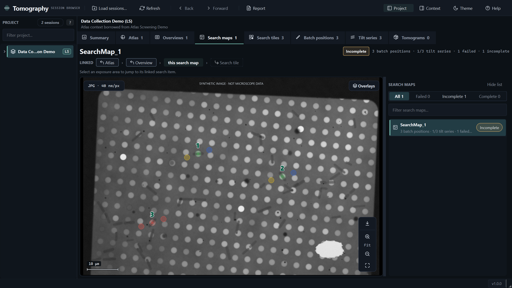
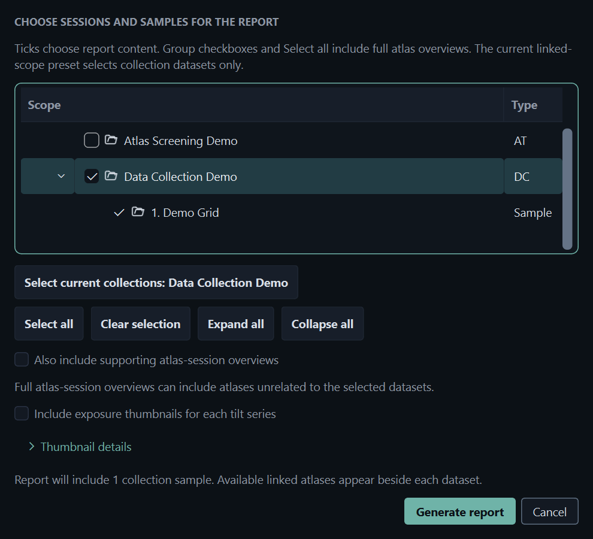
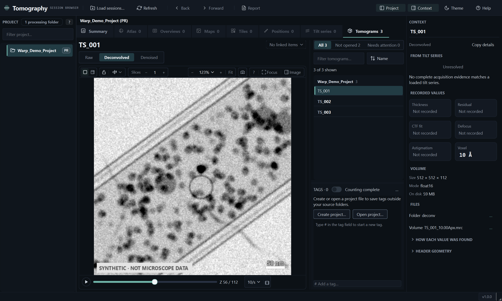
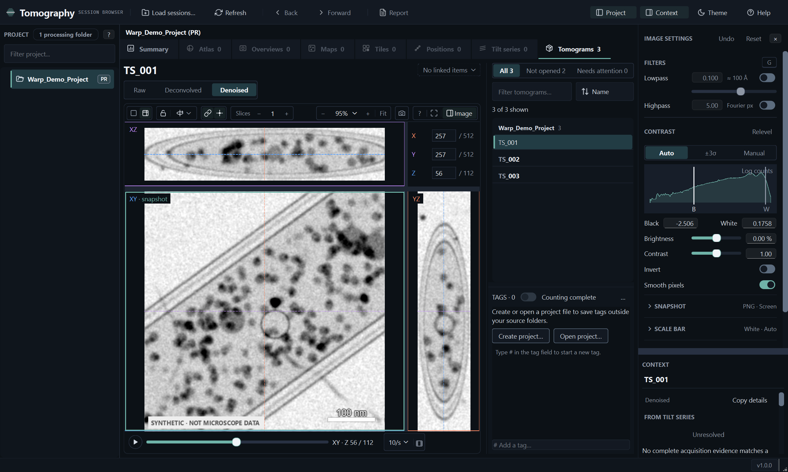
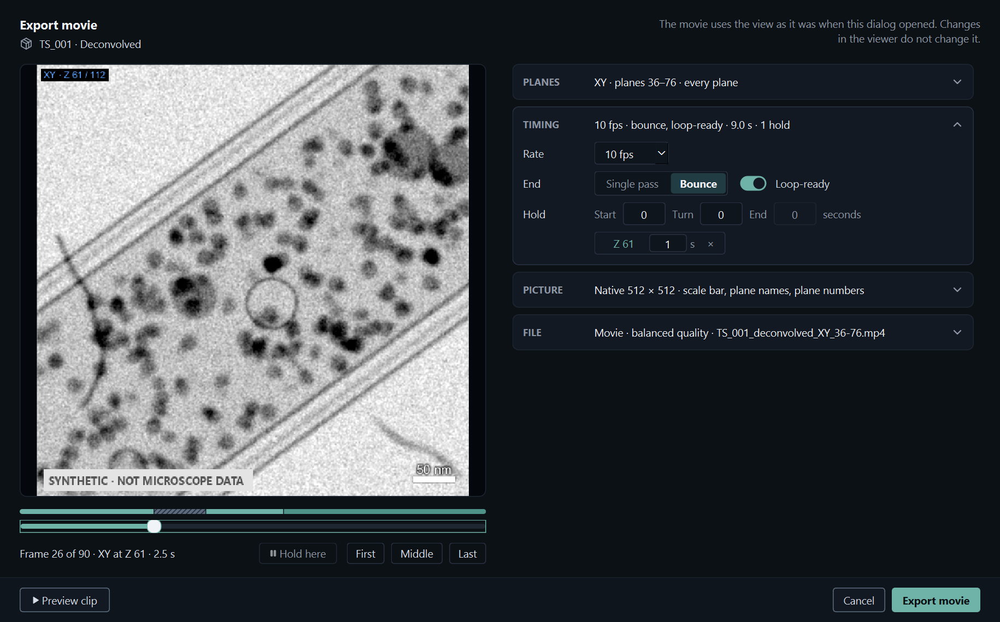
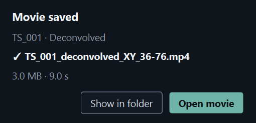

# Tomography Session Browser

Tomography Session Browser is a desktop application for Thermo Fisher Tomography 5 session folders. Use it to review session images and metadata. Use it to find incomplete or failed tilt series. Use it to make PDF reports of a selected scope.

The application also reads tomograms from Warp, IMOD, AreTomo3 and Scipion processing folders. Use it to review the planes of a tomogram and to export a movie. See [Review tomograms](#review-tomograms).

The application is read-only. It does not edit, repair, rename, move or change files in microscope-output folders or processing folders.

Save PDF reports, images, snapshots and movies in a folder that is not in a loaded source folder. This rule applies to all loaded folders, also when they are not in the selected scope.

This is version 1.1.0. The [change log](CHANGELOG.md) lists the changes in each release.

## Supported platforms

| Operating system | Terminal to use |
|---|---|
| Windows | PowerShell, Miniforge Prompt or Anaconda Prompt |
| Linux | Bash |
| macOS | Terminal with Zsh or Bash |

The installation puts the application in an isolated Conda environment. It does not change the Python installation of the system.

## Before you start

These items are necessary:

- A 64-bit Windows, Linux or macOS computer with a graphical desktop.
- [Git](https://git-scm.com/downloads). This is not necessary if you download a ZIP archive.
- A Conda-compatible installer. See the [Conda installation instructions](https://docs.conda.io/projects/conda/en/stable/user-guide/install/).
- An unchanged Thermo Fisher Tomography 5 session folder, or a supported Warp, IMOD, AreTomo3 or Scipion processing folder. See [supported layouts](#1-load-a-processing-folder).

If you do not have Conda, install it. Then close the terminal and open it again. To make sure that Conda is available, run this command:

~~~text
conda --version
~~~

## Install and start the application

### Windows PowerShell

Copy the HTTPS repository URL. Open PowerShell. Then run:

~~~powershell
git clone PASTE_REPOSITORY_URL_HERE
Set-Location Tomography-5-session-viewer
conda env create -f environment.yml
conda activate tomoapp_session
python -m pip install -e .
tomo_session_viewer
~~~

### Linux or macOS

Copy the HTTPS repository URL. Open a terminal. Then run:

~~~bash
git clone PASTE_REPOSITORY_URL_HERE
cd Tomography-5-session-viewer
conda env create -f environment.yml
conda activate tomoapp_session
python -m pip install -e .
tomo_session_viewer
~~~

If you downloaded a ZIP archive, extract it. Open a terminal in the extracted folder that contains environment.yml. Start with the `conda env create` command above.

If the start command does not operate, use this command:

~~~text
python -m tomography_session_browser.main
~~~

### Build the optional CPU sampler

The installation can build an optional C++17 CPU sampler. This sampler makes oblique slice averaging faster. The installation must find one of these compilers:

- On Windows, MSVC Build Tools.
- On Linux, GCC or Clang.
- On macOS, Xcode Command Line Tools.

Run `python -m pip install -e .` again after you install a compiler, or after you copy this folder to a different computer. A Windows binary does not operate on Linux. GPU software is not necessary.

To check the sampler, run this command in the Python environment of the application:

~~~text
python -c "from tomography_session_browser.services.volume.native_reslice import available, variant; print(available(), variant())"
~~~

`True` shows that the compiled sampler loads. The second value gives the build. On most x86-64 computers, this value is `x86-64-v3`. This is a faster build that the application selects when the CPU supports it. The other build is `portable`. The two builds give the same images.

After an update that changes the sampler, run `python -m pip install -e .` again. The application ignores an older build. Thus the check shows `False None` until you build the sampler again. Without a build, the application uses NumPy sampling. This sampling has the same quality, averaging and filters, but it is slower.

### Install FFmpeg for movie export

Movie export runs FFmpeg and ffprobe as external programs. The application looks for them first in its own environment and then on PATH. It does not download FFmpeg. Without FFmpeg, the application can save PNG frames, and the movie dialog tells what is missing.

Use an FFmpeg build that has the H.264 encoder (libx264), for example the conda-forge GPL build. The LGPL build does not have this encoder. The GPL build has GPL licence terms.

#### Linux

Install FFmpeg in the environment of the application:

~~~bash
conda install -n tomoapp_session -c conda-forge "ffmpeg=*=gpl*"
~~~

To make sure that the encoder is available, run this command:

~~~bash
conda run -n tomoapp_session ffmpeg -hide_banner -h encoder=libx264
~~~

The output starts with `Encoder libx264`. Start the application again after you install FFmpeg.

#### Windows and macOS

> [!WARNING]
> On Windows, do not install FFmpeg in the environment of the application. FFmpeg uses the conda-forge ICU library. This library replaces the Windows ICU library that Qt loads. The application then does not start.

Install FFmpeg in its own environment:

~~~text
conda create -n tomoapp_ffmpeg -c conda-forge "ffmpeg=*=gpl*"
~~~

Add the program folder of this environment to the end of PATH. To get the Conda folder, run `conda info --base`. On Windows, the program folder is `<Conda folder>\envs\tomoapp_ffmpeg\Library\bin`. On macOS, it is `<Conda folder>/envs/tomoapp_ffmpeg/bin`.

An FFmpeg from a different source also operates if it is on PATH and has libx264.

Open a new terminal. To make sure that the encoder is available, run this command:

~~~text
ffmpeg -hide_banner -h encoder=libx264
~~~

The output starts with `Encoder libx264`. Start the application again after you install FFmpeg.

## Keep the session folder unchanged

> [!IMPORTANT]
> Select a complete session folder. Do not select a .dm, .mrc, .mdoc, XML, image, Atlas, Batch, SearchMap_* or Sample1 item.
>
> Do not rename files or folders. Do not change letter case. Do not remove folder levels. Do not move files from the session folder.
>
> You can copy a complete session folder for review if its contents stay unchanged.

The application uses the names and paths that Tomography 5 recorded. A changed name or path can cause missing images, empty tabs or unresolved atlas links. Letter case is important on Linux and on case-sensitive macOS file systems.

### Atlas-screening session

Select the top folder that contains ScreeningSession.dm:

~~~text
Atlas_Screening_Session/          <- select this folder
├── ScreeningSession.dm
├── Sample1/                      <- Sample1 or Sample-1 names
│   ├── Sample.dm
│   └── Atlas/
│       ├── Atlas.dm
│       ├── Atlas_*.mrc or Atlas_*.jpg
│       └── Tile_* files
└── ...other Tomography 5 files
~~~

### Multi-grid data-collection session

Select the top folder that contains Session.dm and the sample folders:

~~~text
Data_Collection_Session/          <- select this folder
├── Session.dm
├── Sample1/
│   ├── Session.dm
│   ├── SearchMaps/
│   │   └── SearchMap_*/
│   │       ├── SearchMap.mrc or SearchMap.jpg
│   │       ├── Overview.mrc or Overview.jpg
│   │       └── Tile_* files
│   ├── Batch/
│   │   ├── BatchPositionsList.xml
│   │   └── *_Search.mrc, *_Tracking.mrc, and *_Exposure.mrc
│   └── tilt-series .mrc and .mdoc files
├── Sample2/
└── ...other Tomography 5 files
~~~

Some single-collection exports put Session.dm, SearchMaps, Batch and tilt-series files in the top session folder. Select that folder.

The application loads sessions that are not complete. It shows recoverable problems as warnings.

## Review a session

The screenshots use synthetic data. They contain no microscope or research data.

### 1. Load session folders

Start the application. Drag one or more complete session folders from File Explorer onto the project panel. While you drag, the panel shows the folders that can load, and the cause if a folder cannot load. Release the mouse button to load the folders. The panel does not accept folders during a load.

You can also select **Load sessions** (Ctrl+O). Drop folders on the window, or select **Browse folders…** one time for each folder. The list shows each folder as an atlas screening session or a data collection session. If a folder cannot load, the list tells the cause. You can add one or more atlas and data collection folders to the list. The application adds the loaded folders to the current project.

Below **Browse folders…**, **Recent:** shows a maximum of three folders that you loaded before. It does not show folders that are in the project. Select a folder to add it to the list.

The application examines the folder only when you select it. It loads the folder only when you select the **Load** button. When a folder is in the list, its **Recent:** button is not available.

The application links sessions only when their recorded metadata supports the link. Loaded folders are read-only.

### 2. Examine the project tree and the summary

Wait until the load is complete. The project tree shows the scope that you can review. The **Summary** tab gives this data for the scope:

- The outcome.
- The items in **Needs attention**.
- The acquisition timeline.
- The camera dose.
- The applied defocus, in a wide window.

The contents of the page change with the scope:

- A project, group or session shows its outcome and a table of its samples.
- One sample shows its tilt series, and cards for its atlases, overviews, search maps and batch positions.
- An atlas-only session shows its atlases as a contact sheet.

A count or link on these pages opens the rows that it counts. If the scope has linked tomograms, the first card shows their number. Click it to open them in the **Tomograms** tab. When you select a different dataset in the project tree, the current tab stays open.

| Badge | Meaning |
|---|---|
| LS | Linked atlas and data-collection session |
| AT | Atlas-only session |
| DC | Data-collection session |
| ! | Unresolved or ambiguous atlas link. Read the warning. |

### 3. Review images and metadata

Use the **Atlas**, **Overview**, **Search map**, **Search**, **Batch position** and **Tilt series** tabs. Select an item to examine its image, overlays, status, metadata and navigation. Tab counts agree with the selected project, session or sample scope.

- Lists put rows in groups by sample, batch position or inferred batch.
- Overview rows count their recorded batch positions and tilt series. Use **With acquisitions** or **No acquisitions** to filter them.
- An Atlas row shows a linked collection sample and its tilt-series count when only one sample is loaded. Use **Missing** to filter these rows.
- Other tabs have **Failed**, **Complete** and **Incomplete** for search maps.
- Select **All** or type a filter to review other rows.
- A list of one item can become a selector.
- On the **Batch position** tab, numbered buttons select an exposure area, as a click on the area does.
- If the jump buttons do not fit, they go into one **Go to** button.
- If an atlas has no image file, its page tells this and gives its metadata.

Warnings, and failed or incomplete labels, are correct results when data or links are missing. The application shows unresolved information. It does not make a scientific link.

In an Atlas view of the full grid, batch positions that are near each other show as clusters with a count. When you zoom in, a cluster opens and shows its positions. When you zoom out, the positions go into the cluster again. With reduced motion, this occurs immediately. Zoom in to show short batch IDs. Search-map areas and tile grids show only when you can read them.

Select a batch marker to examine it. Double-click a marker to open its verified linked Overview. If more than one target is available, the application does not open a target. It tells the cause.

Use the **Overlays** panel to set clusters, labels, tile grids, the marker legend and the detail layer for each exposure. The detail layer is off by default. At a linked project node, use **Data collections** to set the markers for each collection. If you select one data-collection node, Atlas batch markers show only for that collection.

Select **Remove all overlays** to hide all overlays in the current tab. This includes the scale bar and the marker legend. The application keeps your **Data collections** selections. Select individual checkboxes to show overlays again.

Double-click an exposure area in an Overview or Search-map image to open its search tile. You can also select the area and press Enter. This does the same as the **Search** jump.

If more than one search tile agrees with the exposure, or if there is no recorded tile, the application does not open a tile. It tells the cause. The tile highlights the selected exposure only when one exposure on the tile agrees with it. If not, the tile has no highlight, and the status bar tells this.

In an Overview or Search-map image, middle-click or Shift-click an exposure area to highlight all exposure areas of the same batch position. To remove the highlight, left-click an empty area, right-click the image or press Escape.

Use the export button above the zoom control, or press **Ctrl+S**, to save the current crop as a high-resolution PNG. The PNG includes the markers and highlights that you can see, the scale bar and the optional Atlas marker legend. It does not include viewer controls or the pixel-size badge.

### 4. Make a PDF report

Select **Report**. Select a linked group, a session or data-collection samples. Each dataset includes its linked atlas when the atlas session is loaded and the link is not ambiguous. The default report does not include the full supporting screening session.

Select **Also include supporting atlas-session overviews** to add the full screening overview. This can add atlases that are not related. Select an Atlas session alone to make an atlas-only report. Examine the scope preview. Then select **Generate report**.

Select **Include exposure thumbnails for each tilt series** to add an image of each exposure area. Tomography 5 keeps a smaller copy of each tilt-series stack in a `Thumbnails` folder adjacent to the stacks. An **Exposures** section follows the tilt-series table of the dataset. It shows one frame from each copy, with four frames on a page.

- The frame is the one nearest 0°. For a lamella session, the frame is the one nearest the pretilt. The pretilt is the angle at which the tilt series started.
- The section gives the stage tilt and the pretilt one time.
- Each image shows the tilt-series status, acquisition time, camera dose of that image (**Cam. dose**) and stage position.
- An image that has no frame at the correct angle shows a warning.
- The report gives the name of each tilt series that has no thumbnail or no recorded tilt angles.

The application keeps this selection.

When processing folders are loaded, the dialog also shows them. Tick a folder and select **Include linked tomograms** to add a Tomograms section to each dataset. Select **Include central slices** to add one image of each linked tomogram. Tick only folders to make a folder report. A folder report shows all tomograms in the ticked folders. For each tomogram that has no link, it gives the cause.

The report starts with a summary page. This page has count cards, a contents list and grouped warnings. The contents list has page numbers and the tilt-series outcomes of each dataset.

Each dataset has its own pages after the summary page. Its atlas shows only batch-position status, as in the Atlas tab. The full atlas shows at fit zoom, adjacent to a larger area in which each position has a number. PDF bookmarks link to all datasets and their figure sections.

Reports do not include workstation source paths. They keep session and dataset names. A report with tomograms includes the review tags, counts and notes as they were when the report dialog opened, also unsaved edits. The report does not remove names or paths that you wrote in a note. Tilt-series tables show the original pixel size and the MRC pixel size in Å/px. An asterisk shows a metadata estimate when MRC sampling is not available. Overview and search-map images do not show the template reference rectangle. Acquisition overlays stay on the images.

## Review tomograms

The application reads reconstructed volumes from processing folders. It does not change these folders. The screenshots in this section show a synthetic volume. They contain no microscope or research data.

### 1. Load a processing folder

Select **Load sessions** (Ctrl+O), or drag the folder onto the project panel. Select the folder that the table gives for your source:

| Source | Select this folder | The folder contains |
|---|---|---|
| Warp | The Warp processing folder | `warp_tiltseries.settings`, or the `warp_tiltseries` and `tomostar` folders |
| IMOD | The folder of the reconstruction | `tilt.com`, `tilta.com` or `tiltb.com`, with an output path in the folder |
| AreTomo3 | The AreTomo3 output folder | `MdocDone.txt` and `*_Vol.mrc` files |
| Scipion | One job folder, for example `Runs/000742_ProtImodTomoReconstruction`, or its `extra` folder | `extra` and `logs` folders; the tomograms are in `extra` |
| Reconstruction folder | The folder of the volumes | `.mrc`, `.rec` or `.map` files with the IMOD `TILT: Tomographic reconstruction` header label, or with MRC space group 1 |

A reconstruction folder can hold the files directly, or one folder for each tomogram. The application does not search other folders near the selected folder. It shows a warning for each file that it cannot identify.

For Scipion, select one job at a time. The application does not load the project folder or its `Runs` folder, because it does not search the jobs in them. The job folder and its `extra` folder are the same source. The application keeps the full job folder unchanged, also its `logs` folder. Tomograms in `extra/<tilt series>/` get the name of their tilt series. In a cryoCARE job, the application reads `<tilt series>_denoised/<tilt series>_.mrc` as the denoised volume. Files that end in `_even` or `_odd` are the half sets of the tomogram of the same name.

### 2. Select a tomogram and read its planes

Select the **Tomograms** tab. Select a tomogram in the list. Use **All**, **Not opened** and **Needs attention** to filter the list. Select the version above the viewer: **Raw**, **Deconvolved** or **Denoised**.

- Drag the slider, or press PageUp or PageDown, to move through the planes.
- Select **Play**, or press Space, to show the planes at the selected rate.
- Set **Slices** to show the average of adjacent planes.
- Select **Focus**, or press Ctrl+M, to make the viewer larger. Do this again to show the panels.

The Context panel shows the values that the processing folder records, and the source of each value. **Not recorded** tells that the folder does not give that value. When a link to a tilt series is verified, the menu above the viewer opens that tilt series.

To see the result of all tomograms in a folder, select the folder in the project tree. Then select the **Summary** tab. This page shows an outcome card, charts of the recorded values, and lists of the values and volumes.

### 3. Compare planes and set the display

Select the Ortho button to show three planes. Select the Single button to show one plane.

- Click a pane to make it the active pane. The slider, PageUp and PageDown then move through this pane.
- Select **Link** to give the panes the same scale and centre.
- Use the angle menu to turn the view to an oblique angle. The lock button (Ctrl+L) keeps the point that the view turns around.
- Select **Image** to open the image settings. These settings change only the display.

The image settings have filters, contrast, a histogram, a calibration, snapshot settings and scale-bar settings. **Memory** sets the limit for the RAM that tomogram views and exports share.

If a version has no usable pixel size, the application asks you for a value and does not show a scale bar until you give one. When two or more versions need a value, **Apply to several…** shows a list of these versions so that you can give them one value. The application cannot check that these versions have the same voxel size, so make sure that they do. The value is kept after a restart, and **Undo** removes it. If a file changes, the application asks again. The application does not change the MRC files.

### 4. Save snapshots and tags

Select an output folder that is not in a source folder. To save the area that you can see, select the camera button or press Ctrl+S. The file type can be PNG, TIFF or JPEG. In the Ortho view, a snapshot saves the active pane.

**Captures** can show a saved view again, also after you start the application again. **Captures > Export contact sheet (PDF)** exports 1 to 24 selected captures, with four captures on each page.

When you load the same source again, the application shows **Resume saved view**. It does not show the saved view until you select this.

To keep tags, counts and notes, select **Create project…** or **Open project…** in the tag panel. This project file is not in your source folders. Type `#` in the tag field to start a new tag. The menu of the tag panel can export the tags as a CSV file.

To save a snapshot linked to a specific tag:

1. Select the tomogram, open or create its tag project, and add the tag to that tomogram.
2. Set the view that you want to save: version, plane, angle, zoom and image settings.
3. Right-click the assigned tag row and select **Snapshot and link**. If asked, choose an output folder outside all loaded source folders.
4. Click the camera beside the tag to open its linked captures. The number beside the camera is the number of linked captures, not the observation count.

Use **Link captures…** in the same menu to attach existing snapshots. When a tag has no linked captures, its camera shows only when you hover over or focus the tag row. Click that camera to open the menu containing **Snapshot and link**. The ordinary viewer camera and Ctrl+S save a snapshot without automatically linking it to a tag.

### 5. Export a movie

1. Set the view in the viewer. The movie uses the view as it was when the dialog opened.
2. Click the film button adjacent to the rate, or press Ctrl+E.
3. Open each card and set its values:
   - **Planes**: the sweep, the first and last plane, and the step.
   - **Timing**: the rate, one pass or a bounce, **Loop-ready**, and the holds.
   - **Picture**: the size, the shape, and the items to show on the picture.
   - **File**: the file type, the compression, the folder and the name.
4. Drag the slider below the picture to see each frame. Select **Hold here** to stop the movie at that frame for a time.
5. Select **Preview clip** to play the movie in the dialog.
6. Select **Export movie**.

When the export is complete, select **Show in folder** or **Open movie**.

The dialog keeps your settings for each tomogram until you close the application, also if you select **Cancel**. All versions of a tomogram share these settings. Thus you can export again at a different quality. You can also make a movie of a different version with the same settings.

The application does not replace a file. It does not accept a folder in a loaded source. To save MP4 files, you must have FFmpeg. See [Install FFmpeg for movie export](#install-ffmpeg-for-movie-export). You can save PNG frames without FFmpeg.

## Update an installation

Open a terminal in the repository folder. Run:

~~~text
git pull
conda env update -n tomoapp_session -f environment.yml --prune
conda activate tomoapp_session
python -m pip install -e .
~~~

If you installed from a ZIP archive, download and extract the new version. Then run the last three commands in the new folder.

The `--prune` option removes packages that are not in environment.yml. On Linux, this includes FFmpeg. After an update, run the FFmpeg command in [Linux](#linux) again.

## Troubleshooting

### conda is not recognised

Close the terminal after you install Conda, and open it again. On Windows, use the Miniforge Prompt or Anaconda Prompt. On Linux or macOS, run this command one time. Then open the terminal again:

~~~text
conda init
~~~

### The environment already exists

Update the environment:

~~~text
conda env update -n tomoapp_session -f environment.yml --prune
conda activate tomoapp_session
python -m pip install -e .
~~~

### tomo_session_viewer is not recognised

Activate the environment. Install the application again from the repository root:

~~~text
conda activate tomoapp_session
python -m pip install -e .
python -m tomography_session_browser.main
~~~

### The application does not accept the folder, or tabs are empty

- Make sure that you selected a complete session folder.
- Do not select Session.dm, ScreeningSession.dm, Atlas, Batch, SearchMaps, SearchMap_* or one MRC file.
- Make sure that the names, letter case and folder levels are unchanged.
- For atlas screening, make sure that the selected folder contains ScreeningSession.dm.
- For multi-grid collection, make sure that the selected folder contains Session.dm and sample folders.
- Read each application warning. An acquisition that is not complete can have missing previews or unresolved links.

### Linux shows a Qt platform-plugin error

Run the application in a graphical desktop session. Do not use an SSH session that has no display. If the error gives the name of a missing library, use the Qt or PySide instructions for your Linux distribution.

### The application cannot save settings

The application writes a warning to its log when the user configuration folder is read-only. You can continue to review sessions and make reports. The application does not keep settings in source folders.

## Developer use

The project uses Python 3.11, PySide6, Pillow, NumPy, ReportLab and pytest. An editable installation keeps the start command connected to the current working copy:

~~~text
conda env create -f environment.yml
conda activate tomoapp_session
python -m pip install -e .
~~~

The public repository has a minimal release suite. This suite uses only synthetic data:

- `test_release_smoke.py` starts the application in the two themes, examines the loader assets and release version, and checks that volume headers and acquisition records keep tomograms separate from tilt stacks.
- `test_hardening_regression.py` makes sure that damaged input causes warnings, not crashes. It also makes sure that the dashboard and the reports show the same number of warnings.
- `test_project_model.py` examines session links, project groups and report generation.
- `conftest.py` keeps the tests away from your own settings.

The full development suite is not in this repository. The release suite does not replace it.

Run the release tests:

~~~text
conda run -n tomoapp_session python -m pytest --basetemp .pytest_tmp
~~~

Run a compile check:

~~~text
conda run -n tomoapp_session python -m compileall tomography_session_browser tests tools
~~~

Make public README screenshots with synthetic data:

~~~text
conda run -n tomoapp_session python tools/generate_readme_screenshots.py
~~~

For the movie screenshots, FFmpeg must be on PATH.

For a UI or report change, start the application. Open a session that has no sensitive data. Examine the changed scopes and tabs. If possible, make a PDF of the scope. Do not commit microscope-session data or screenshots that contain sensitive data.

## Scope and data safety

- Use this application with Thermo Fisher Tomography 5 session layouts and the supported processing folders.
- Use it to review acquisition metadata, images and tomograms. Do not use it for reconstruction.
- The application keeps parsed models and project groups in memory.
- The application does not repair or write to source folders.
- The application shows ambiguous or missing scientific links as warnings.

## License

This project uses the [MIT License](LICENSE).
